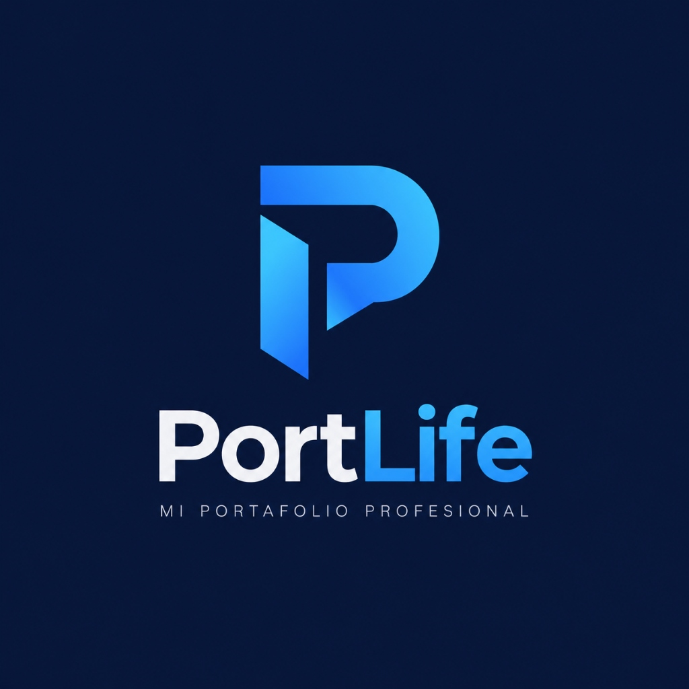

# 🚀 PortLife — Portafolio Profesional Full Stack



**PortLife** es una aplicación web full stack completa, moderna y responsiva desarrollada para la presentación profesional de un estudiante de **Ingeniería Informática**. El proyecto ha sido construido para cumplir con todos los requerimientos académicos del parcial universitario de Desarrollo Web, integrando una arquitectura limpia con **Frontend**, **Backend**, **Base de Datos Relacional** y un **Panel Administrativo Funcional** con control de acceso seguro.

---

## 📋 Tabla de Contenidos
1. [Características Principales](#-características-principales)
2. [Arquitectura y Tecnologías](#-arquitectura-y-tecnologías)
3. [Estructura del Proyecto](#-estructura-del-proyecto)
4. [Instalación y Ejecución Local](#-instalación-y-ejecución-local)
5. [Panel Administrativo y Credenciales](#-panel-administrativo-y-credenciales)
6. [Endpoints de la API REST](#-endpoints-de-la-api-rest)
7. [Seguridad y Buenas Prácticas](#-seguridad-y-buenas-prácticas)
8. [Despliegue en Render y GitHub (Producción)](#-despliegue-en-render-y-github-producción)
9. [Guía para la Sustentación Universitaria](#-guía-para-la-sustentación-universitaria)

---

## 🌟 Características Principales

### 🌐 Portafolio Público
* **Inicio (Hero Section):** Identidad del estudiante, título profesional, carrera, universidad, semestre actual, botones de acción (*Ver Proyectos*, *Contactar*) y avatar tecnológico personalizado.
* **Información Personal (Sobre Mí):** Ficha académica detallada, biografía, objetivos profesionales y áreas de interés en la disciplina informática.
* **Estudios Realizados:** Línea de tiempo académica interactiva con estado de formación (*En curso* vs. *Culminado*), instituciones y periodos.
* **Proyectos Desarrollados:** Tarjetas dinámicas con imágenes de alta definición, etiquetas de tecnologías, estado de avance (*GlucoKids*, *PetCare*, *Hablemos*), enlaces a repositorios y modales con descripción técnica ampliada.
* **Lenguajes y Tecnologías:** Clasificación de habilidades por categorías (*Frontend, Backend, Bases de Datos, Herramientas*) con barras de progreso animadas y porcentajes realistas.
* **Áreas de Interés:** Tarjetas explicativas sobre Desarrollo Web Full Stack, Inteligencia Artificial, Automatización de Procesos y Creación de Aplicaciones.
* **Formulario de Contacto Funcional:** Validación rigurosa tanto en JavaScript como en Flask, guardado persistente en base de datos y confirmación dinámica vía AJAX.

### 🛡️ Panel Administrativo (`/admin`)
* **Autenticación Segura:** Control de acceso mediante `Flask-Login` y contraseñas hasheadas criptográficamente con algoritmo `pbkdf2:sha256` / `scrypt` mediante `Werkzeug`.
* **Dashboard con Métricas:** Indicadores en tiempo real de proyectos registrados, estudios, habilidades y mensajes no leídos.
* **CRUD de Proyectos:** Creación, edición, ordenamiento y eliminación de proyectos.
* **CRUD de Formación:** Administración de carreras, diplomados y certificaciones.
* **CRUD de Habilidades:** Ajuste de tecnologías, niveles cualitativos y porcentajes de dominio.
* **Gestor de Perfil:** Actualización instantánea de nombre, biografía, datos universitarios y redes sociales.
* **Bandeja de Mensajes:** Lectura de mensajes de contacto, cambio de estado (leído/no leído) y eliminación.

---

## 🛠️ Arquitectura y Tecnologías

### Frontend:
* **HTML5 Semántico:** Estructura accesible con encabezados jerárquicos y atributos para SEO.
* **CSS3 Personalizado (`static/css/style.css`):** Diseño visual tecnológico de alto nivel en paleta *Deep Navy* (`#070c1b`) y acentos *Electric Blue* (`#00d2ff`), tarjetas glassmórficas y micro-animaciones fluidas.
* **JavaScript Puro (`static/js/main.js`):** Peticiones asíncronas con `fetch` API, validación reactiva de formularios, filtros dinámicos y control de modales sin dependencias de frameworks pesados como React.
* **Bootstrap 5 (CDN):** Sistema de grilla responsiva, utilidades y componentes modales.
* **Bootstrap Icons:** Iconografía tecnológica ligera y estandarizada.
* **Google Fonts:** Tipografías modernas *Outfit* (títulos) y *Plus Jakarta Sans* (cuerpo de lectura).

### Backend:
* **Python 3.11+ / 3.14+**
* **Flask:** Microframework web modular y eficiente.
* **Flask-SQLAlchemy:** Mapeador objeto-relacional (ORM) para interacción segura con la base de datos sin concatenación de SQL (prevención de SQL Injection).
* **Flask-Login:** Gestión robusta de sesiones de usuario y protección de rutas mediante `@login_required`.
* **Werkzeug Security:** Generación y verificación segura de hashes de contraseñas.
* **Gunicorn:** Servidor WSGI para despliegue de alto rendimiento en entornos Unix/Linux.

### Base de Datos:
* **Desarrollo Local:** SQLite (`portlife.db`), archivo ligero sin necesidad de configurar servicios adicionales.
* **Producción (Render / Cloud):** PostgreSQL mediante variable de entorno `DATABASE_URL` (compatible con psycopg2-binary y ajuste automático `postgres://` -> `postgresql://`).

---

## 📂 Estructura del Proyecto

```text
PortLife/
│
├── app.py                  # Fábrica de la aplicación, configuración de extensiones y CLI
├── config.py               # Ajustes centralizados, soporte de SQLite y PostgreSQL
├── models.py               # Modelos SQLAlchemy (User, Profile, Project, Study, Skill, etc.)
├── seed.py                 # Población inicial de datos reales para demostración
├── requirements.txt        # Lista de dependencias de Python
├── Procfile                # Comando de ejecución para producción en Render (gunicorn)
├── render.yaml             # Blueprint de despliegue automatizado para Render
├── .env.example            # Guía de variables de entorno recomendadas
├── .gitignore              # Exclusión de archivos temporales, logs y bases de datos locales
├── README.md               # Documentación integral del proyecto
│
├── routes/                 # Controladores y rutas modulares (Blueprints)
│   ├── public.py           # Rutas públicas y endpoints de la API REST
│   └── admin.py            # Rutas y controladores CRUD protegidos del panel administrativo
│
├── templates/              # Vistas HTML con motor Jinja2
│   ├── base.html           # Plantilla base con CDN y pie de página
│   ├── index.html          # Vista pública principal del portafolio
│   ├── 404.html            # Manejador de ruta no encontrada
│   ├── 500.html            # Manejador de error interno de servidor
│   └── admin/              # Vistas del panel de administración
│       ├── base_admin.html # Plantilla base del panel con sidebar
│       ├── login.html      # Formulario de inicio de sesión seguro
│       ├── dashboard.html  # Resumen de estadísticas y accesos rápidos
│       ├── projects.html   # Tabla CRUD y modales de proyectos
│       ├── studies.html    # Tabla CRUD y modales de estudios
│       ├── skills.html     # Tabla CRUD y modales de habilidades
│       ├── profile.html    # Formulario de edición del perfil
│       └── messages.html   # Bandeja de entrada de mensajes de contacto
│
└── static/                 # Recursos estáticos servidos por Flask
    ├── css/
    │   ├── style.css       # Estilos visuales del portafolio (Cyber Navy & Cyan)
    │   └── admin.css       # Estilos específicos del panel administrativo
    ├── js/
    │   ├── main.js         # Lógica frontend pública (AJAX, validaciones, filtros)
    │   └── admin.js        # Lógica de carga modal para edición en el panel
    └── img/
        ├── logo.png        # Logotipo oficial de PortLife
        ├── glucokids.jpg   # Captura de interfaz del proyecto GlucoKids
        ├── petcare.jpg     # Captura de interfaz del proyecto PetCare
        ├── hablemos.jpg    # Captura de interfaz del proyecto Hablemos
        └── student_avatar.jpg # Fotografía / avatar del estudiante de ingeniería
```

---

## 💻 Instalación y Ejecución Local

### Prerrequisitos
* Tener instalado **Python 3.10** o superior en el sistema.
* Tener instalado **Git** (opcional para clonación).

### Paso 1: Clonar o abrir la carpeta del proyecto
```bash
cd PortLife
```

### Paso 2: Crear y activar un entorno virtual (Recomendado)
* **En Windows (PowerShell / CMD):**
  ```powershell
  python -m venv venv
  .\venv\Scripts\activate
  ```
* **En Linux / macOS:**
  ```bash
  python3 -m venv venv
  source venv/bin/activate
  ```

### Paso 3: Instalar las dependencias
```bash
pip install -r requirements.txt
```

### Paso 4: Configurar variables de entorno (Opcional)
Puedes crear un archivo `.env` basado en `.env.example`:
```env
SECRET_KEY=clave_secreta_super_segura_2026
ADMIN_USERNAME=admin
ADMIN_PASSWORD=admin123
```
*(Si no se define ningún archivo `.env`, el sistema usará valores por defecto para permitir su ejecución inmediata en desarrollo).*

### Paso 5: Iniciar el servidor local
```bash
python app.py
```
O utilizando el CLI de Flask:
```bash
flask run --port=5000
```

### Paso 6: Abrir en el navegador
Ingresa a: **`http://127.0.0.1:5000`**

---

## 🔐 Panel Administrativo y Credenciales

Para ingresar a gestionar el portafolio, accede a la ruta:
👉 **`http://127.0.0.1:5000/admin/login`**

### Credenciales por Defecto (Entorno de Desarrollo):
* **Usuario:** `admin`
* **Contraseña:** `admin123`

*(Estas credenciales pueden ser cambiadas desde variables de entorno o mediante el comando `flask create-admin`).*

---

## 📡 Endpoints de la API REST

Además de las vistas renderizadas por servidor (SSR con Jinja2), la aplicación ofrece endpoints RESTful para interoperabilidad y consultas asíncronas:

| Método | Endpoint | Descripción | Autenticación |
|---|---|---|---|
| `GET` | `/api/profile` | Retorna los datos personales y académicos del perfil en formato JSON | Pública |
| `GET` | `/api/projects` | Lista todos los proyectos (permite filtro `?category=...`) | Pública |
| `GET` | `/api/projects/<id>` | Retorna el detalle completo de un proyecto por su ID | Pública |
| `GET` | `/api/studies` | Lista la trayectoria académica y estudios cursados | Pública |
| `GET` | `/api/skills` | Retorna las tecnologías y niveles de conocimiento | Pública |
| `POST` | `/api/contact` | Guarda un mensaje de contacto enviado en formato JSON | Pública |

---

## 🔒 Seguridad y Buenas Prácticas

1. **Protección contra Inyección SQL:** Todas las consultas a la base de datos se ejecutan a través del ORM de **SQLAlchemy**, el cual parametriza automáticamente las consultas y previene ataques de inyección.
2. **Cifrado de Contraseñas:** Ninguna clave se almacena en texto plano. Se emplea `generate_password_hash` con sales criptográficas y algoritmos resistentes a fuerza bruta.
3. **Validación Dual:**
   * **Frontend:** Se verifica formato de correo electrónico y longitudes mínimas en tiempo real para mejorar la experiencia de usuario.
   * **Backend:** Flask valida nuevamente cada campo antes de ejecutar operaciones en la base de datos.
4. **Protección de Rutas Administrativas:** Toda acción de creación, actualización o eliminación en `/admin` está resguardada por el decorador `@login_required`.
5. **Escape Automático de Contenido:** El motor Jinja2 escapa automáticamente variables para evitar vulnerabilidades de Cross-Site Scripting (XSS).
6. **Manejo de Errores Limpio:** Se implementaron páginas personalizadas para errores `404` (No encontrado) y `500` (Error de servidor) para evitar la fuga de trazas técnicas al usuario final.

---

## ☁️ Despliegue en Render y GitHub (Producción)

### 1. Subir el proyecto a GitHub
```bash
git init
git add .
git commit -m "feat: Portafolio profesional PortLife con Flask y SQLAlchemy"
git branch -M main
git remote add origin https://github.com/TU_USUARIO/PortLife.git
git push -u origin main
```

### 2. Despliegue en Render
1. Inicia sesión en [Render.com](https://render.com/).
2. Haz clic en **New +** y selecciona **Web Service**.
3. Conecta tu repositorio de GitHub `PortLife`.
4. Render detectará automáticamente el archivo `render.yaml` o puedes configurarlo manualmente:
   * **Runtime:** Python 3
   * **Build Command:** `pip install -r requirements.txt`
   * **Start Command:** `gunicorn app:app`
5. En la sección **Environment Variables**, define:
   * `SECRET_KEY`: Una cadena aleatoria segura.
   * `ADMIN_USERNAME`: Tu usuario de administrador deseado.
   * `ADMIN_PASSWORD`: Tu contraseña secreta para el panel.
   * *(Opcional)* Conecta una base de datos PostgreSQL de Render. La variable `DATABASE_URL` será inyectada automáticamente y la aplicación adaptará las tablas de inmediato.

---

## 🎓 Guía para la Sustentación Universitaria

Si el evaluador o docente realiza preguntas técnicas durante la sustentación, estos son los argumentos clave del proyecto:

1. **¿Por qué Flask en lugar de Django o frameworks complejos?**
   * *Respuesta:* Flask proporciona un diseño minimalista, transparente y pedagógico. Permite estructurar la arquitectura por componentes (Blueprints), controlar con precisión el ciclo de vida de la petición HTTP y evitar capas de abstracción innecesarias para el alcance del proyecto.

2. **¿Cómo se maneja la persistencia de datos entre desarrollo y producción?**
   * *Respuesta:* A través del patrón de configuración en `config.py`. En local se utiliza **SQLite**, permitiendo desarrollo rápido sin dependencias externas. En producción se utiliza la variable de entorno `DATABASE_URL` conectada a **PostgreSQL**, con auto-corrección de protocolo (`postgres://` a `postgresql://`).

3. **¿Cómo se protegen las contraseñas del panel administrativo?**
   * *Respuesta:* Se emplea la librería `werkzeug.security` con hashing criptográfico (`pbkdf2:sha256`). La contraseña nunca se almacena en texto plano ni se expone en respuestas JSON.

4. **¿Cómo funciona el envío del formulario de contacto?**
   * *Respuesta:* Utiliza una arquitectura híbrida: procesa solicitudes convencionales POST y peticiones asíncronas vía `fetch` (AJAX). Valida en cliente y servidor, guarda el registro en la tabla `contact_messages` de SQLAlchemy y retorna retroalimentación visual al usuario únicamente cuando la confirmación de la base de datos es exitosa (`commit`).

---

**Desarrollado para el Parcial de Desarrollo Web — Universidad Tecnológica**  
*PortLife — Ingeniería de Software con Excelencia.*
